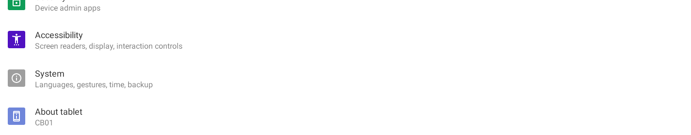
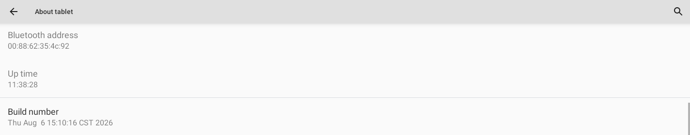
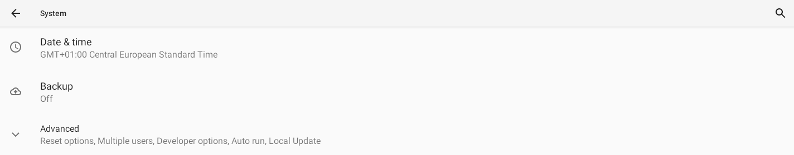
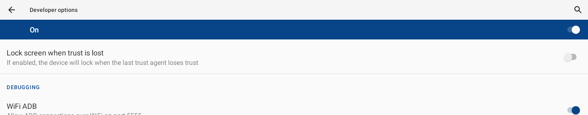

# Deckhand — User Manual

Deckhand is an independent, community macOS app for Sanytron **UltraBar X** hardware (CoreBar + QuantumLink modules: VivoCube, SenseCube, KnobKey, DotKey, PC-Boot card). Not affiliated with or endorsed by Sanytron. The vendor's product page, with photos of the bar and each module, is at https://www.sanytron.com/products/ultrabar-x-the-modular-desktop-command-center.

---

## 1. Install

1. Open **Deckhand.dmg** and drag **Deckhand** onto the **Applications** folder.
2. A notarized build (the DMG's "Read Me First" says so) opens like any other app. An ad-hoc-signed build — the first prerelease, or one you built yourself without a Developer ID — is blocked by macOS on the first launch. To open it the first time:
   - In **Applications**, **right-click** (Control-click) **Deckhand** → **Open** → **Open** in the dialog.
   - If that doesn't offer "Open": **System Settings → Privacy & Security**, scroll down, and click **Open Anyway** next to Deckhand.
   - You only do this once.
3. On first scan macOS asks for **Local Network** permission — click **Allow** (the app can't find the CoreBar otherwise). On first use of the Music controls (Widgets → Music) it asks for **Automation** permission to control Music — click **OK**. The Calendar widget asks for **Calendar** access the first time you enable it.

Deckhand runs on macOS 13 or later. On macOS 26 and later it uses the system's Liquid Glass styling; on older versions it looks like a standard macOS app.

**What you need**

- A Mac on macOS 13 or later.
- An UltraBar X with launcher **1.0.9** or later, on the **same network** as the Mac. Wi‑Fi or wired, it does not matter; the Mac and the bar only need to reach each other. The launcher version is the `ver` Deckhand shows in the sidebar after a scan (for example `1.0.9(9)`); on the bar it is under Settings → About tablet. Bars shipped in 2026 came with **1.0.3**, and the bar's own Settings → About may not offer the update: Sanytron publishes the launcher (`LineOS.V1.0.9.9.apk`) and the bridge (`bridge.1.0.4.4.apk`) on its [GitHub releases page](https://github.com/Qinkunex/UltraWorkspace/releases); once the debug bridge below is on, Deckhand installs them for you from Settings → **Bar software** (the bar restarts its launcher; your pages and pairing survive). On 1.0.3 the SenseCube cards and the Deckhand apps' cards do not exist.
- Only for the **Deckhand apps** on the bar (Monitor, Crypto, Flights and the other eight), for **Restart bar launcher** and for the *Keep the screen on* option: Android's debug bridge, `adb`, on the Mac, and the bridge switched on at the bar. Install it with `brew install --cask android-platform-tools` (needs [Homebrew](https://brew.sh)); switching it on at the bar is described under [Turn on the debug bridge (ADB) on the bar](#turn-on-the-debug-bridge-adb-on-the-bar). Everything else (cube cards, CoreBar pages, KnobKey, DotKey, SenseCube, marketplace apps and screensavers) works without it.

---

## 2. Connect the hardware

### Power & the USB cable — read this first

The CoreBar has **two** USB ports. They are not interchangeable:

| Port | Use it for | Rule |
|------|------------|------|
| **USB-OTG** | **Power / charging** — a fast charger (PD / QC, 9–20 V) or the 12 V adapter. | Fast charging is OK here. |
| **PC-LINK** | The vendor's link to a computer: the bar shows up as a USB keyboard plus a channel for Sanytron's own PC app. Deckhand does not use it. | **5 V only.** A computer's USB port or a plain 5 V adapter. |

> ⚠️ **Never plug a phone/MacBook/laptop PD fast-charger into PC-LINK.** PC-LINK is 5 V-only; a 9–20 V charger will permanently damage the mainboard and can overheat. A computer's USB port is electrically safe on PC-LINK (it supplies 5 V only).

**Deckhand needs no USB cable.** It talks to the bar over your network, including the debug bridge. Leave PC-LINK unplugged: plugging it into a computer switches the bar into keyboard mode and turns the bar's WiFi ADB off (verified 2026-11-06). If that happened, switch WiFi ADB off and on in the bar's Developer options, then press **Keep on after reboots** in Settings → Debug bridge.

### Network (how the app actually talks to the CoreBar)

Deckhand controls the CoreBar over **Wi-Fi / your local network**, not over the USB cable. Make sure:

- The CoreBar is connected to the **same Wi-Fi / LAN** as your Mac (check the CoreBar: **Control Center → Wi-Fi**).
- The USB cable can stay connected for power, but discovery and control run over the network.

The same guidance is shown in the app under **Settings → Connecting**.

---

## 3. Connect your CoreBar

The first time, Deckhand shows **Connect your CoreBar**:

1. **Find the bar** — Deckhand looks on your network for about 8 seconds (a progress bar shows it). Your bar appears with a **Pair** button. macOS asks for *Local Network* access the first time; if you declined, use **Local Network permission…** to allow it. Can't see the bar (other subnet, VPN)? **Connect by address…** takes its IP address (shown on the bar under Settings → Network).
2. **Approve on the bar** — press **Pair**; the bar shows an Approve button for 30 seconds (Deckhand shows the countdown). Tap it.
3. Deckhand then finds the modules on its own and opens the **CoreBar**.

The pairing key is stored in a protected, user-only file in Application Support, and the bar's certificate is pinned, so an impostor on the network can't reuse your key. The paired bar is shown at the top of the sidebar (with more than one paired bar it is a menu to switch between them). **Add another CoreBar…**, **Find modules** and **Forget this CoreBar…** are under Settings → CoreBar.

---

## 4. Modules — wake them before looking

**Tap the bar's screen and press a DotKey key before you press Find modules.** Finding modules is a live scan of the magnetic bus, and a module that has gone to sleep — usually the **DotKey** — can be missed. Deckhand remembers every module it has ever seen on your bar and keeps it in the bar's configuration, so a one-time sleep won't drop a module; a scan with everything awake just gives the most reliable result.

**Find modules** is under Settings → CoreBar, under **Maintenance** on the CoreBar page, and in the sidebar when no modules are known yet. The scan takes about 16 seconds and also registers the modules on the bar so they can be controlled. A module that did not answer is marked *asleep* in the sidebar.

---

## 5. Using the app

One window, a sidebar on the left, grouped by what you want to change:

- **Screens** — **CoreBar** (the strip on the bar) and **VivoCube** (the small square screen module).
- **Controls** — **KnobKey**, **DotKey**: what the knob and keys do.
- **Sensors** — **SenseCube**.
- **Library** — **Installed** (everything in use, in one place), **Widgets** (the cards Deckhand can draw), **Apps**, **Screensavers** and **People**.
- **Health** — **Status** and **Logs**.

Every device page starts with a **status strip**: whether Deckhand is connected and answering the bar, what the device is showing right now (read back from the device, not assumed), when something was last sent, and — only when something is wrong — one sentence and one button that fixes it ("The cube is not on Wi-Fi — Set cube Wi-Fi…", "The cube's screen is off — Turn on", "The Deckhand page is gone from the bar — Publish page"). The toolbar, on every page, shows the last thing Deckhand did, the link to the bar ("Connected · 212 requests answered", or "Not connected", "Reconnecting…") and how long ago the bar last asked it something; the **Activity** button next to it opens the list of everything Deckhand did. The strip shows what the device *is*.

### CoreBar
The bar's big screen shows a page: a row of the bar's own cards. About five fit (the Clock card takes the room of two); more scroll sideways. There is no full-screen picture — Deckhand's own picture (weather & date, free, refreshed hourly) is the **Clock** card's picture.

- **Preview** — drawn from your card list, one screenful at a time; ◀ ▶ step through the screenfuls the bar scrolls sideways through. It is not read back from the bar.
- **Cards on the bar** — drag to reorder, ✕ to remove, **Add a card…** below the list. ⌁ marks cards fed live by this Mac (CPU, memory, storage, network, the two buttons): they update only while Deckhand runs; the others keep running when the Mac is off.
- **Weather (bar's own)** is drawn by the bar from **AccuWeather, which is not free** (14-day trial, paid afterwards). Press **Key…** on that row to paste the key; it is sent to the bar with the next publish. Deckhand's own weather on the Clock card costs nothing.
- **Publish page** (⌘↩) — draws the clock picture, uploads the button icons, writes the pages and shows the Deckhand page; the steps are shown under the button. Deckhand asks for confirmation only when it matters: the first time, or when the bar has pages made in the official app (those would be removed — the bar cannot send pages back). The knob and keys get their bindings with every publish (see Controls).
- **Start page** — publishing marks the Deckhand page as the bar's start page, so the bar boots into it; Deckhand also selects it again every time it (re)connects to the bar. Use **Show** in *Pages on the bar* to switch to Standard Mode for a moment.
- **Pages on the bar** / **Maintenance** — the page list, **Find modules**, **Re-read pages**, **Redraw preview**. The official app's Deploy removes Deckhand's pictures; publish again afterwards.

### VivoCube
Shows one card at a time.

- **On the cube now** — the card the cube *reports* it is on, with the picture Deckhand sent for it, "Card 2 of 4" and ◀ ▶ to step through them from the Mac (the DotKey and the bar's button do the same on the device). A dark picture with "Screen off" means the screen is off; an orange Wi-Fi note means the cube is not connected and may still show an old picture.
- **Cards on the cube** — an ordered list of up to 6 cards: drag to reorder, ✕ to remove, **Add a card…** to add (the **Picture** card asks for an image file). The order here is the order on the cube.
- **Switching** — **Stay on one card**, **Switch automatically** every 15 s / 30 s / 1 min / 3 min (a timer on this Mac; Deckhand must be open), or **Only with the DotKey or the bar's button**.
- **Send to cube** (⌘↩) — draws the cards, uploads them as one package, waits about 10 seconds for the cube to apply it and shows card 1. The steps appear under the button; a failure is one sentence with the next thing to do. The cards' contents are redrawn every few minutes while timed switching runs.
- **Maintenance** — **Cube screen** switch (off stays off until you turn it on), **Fix black screen** (screen on + card 1; use it when the cube shows black after a reboot), **Send test picture**, **Restart cube…** (the cube goes dark for about 20 seconds; asks first), **Restart bar launcher…** (over Wi-Fi ADB, for the upload-slot problem described under Troubleshooting; asks first), and **Wi-Fi**: which network the cube is on and whether it is connected. Fresh cubes sit on the bar's own hotspot, which the bar switches off when idle; uploads then cannot reach the cube. **Set cube Wi-Fi…** joins it to your own **2.4 GHz** network (a combined 2.4/5 GHz name may not work; the bar must be on the same network); the password goes to the cube only.

### SenseCube
Live **temperature**, **humidity** and **light**, read every 5 seconds while the page is open. **Add all five** puts the Temperature, Humidity, Light, Presence and Sound level cards on the CoreBar page (the bar draws them itself). Presence (radar) and sound level are push-only: the bar can show them, Deckhand cannot read them. Vibration is only an event on the bar.

### KnobKey and DotKey
What each control does, as it is bound today: knob **turn → Mac volume** (the speakers chosen in System Settings → Sound; the KnobKey page shows which), **press → play / pause in Apple Music**; DotKey **key 1 → previous cube card**, **key 2 → next cube card**, **hold key 3 → Standard page**. These bindings are part of the CoreBar page and are active while that page is on the bar; publish it once to activate them. Changing them is planned.

### Installed
Sidebar → Library → **Installed**: what is on the bar and on the screens right now, in one place, with **Refresh** and **Update all (n)** in the header (the count is how many things have a newer version; the updates run one after another). Four panels: **Apps on the bar** (Deckhand's own apps with **Update** and **Remove**, which go over ADB; marketplace apps with **Web UI**, **Update** and **Remove**; firmware apps can only be updated), **Screensavers on the bar** (the one in use cannot be removed — pick another first), **Cards on the VivoCube** (**Remove** takes the card out of the cube's list) and **Cards on the CoreBar page** (**Remove**, and a line saying whether the page is published to the bar yet). Every **Remove** asks first. To add things, go to the page of that kind: Widgets, Apps or Screensavers.

### Widgets
A list on the left, the chosen card on the right with a switch and its settings. Two sections in the list: **For the VivoCube** (pictures Deckhand draws — only cards that stay valid for 5 minutes, because the cube gets a new picture every 5 minutes at most; live readings and clocks are deliberately not offered there, and the list marks these *snapshot*) and **For the CoreBar** (cards the bar draws itself and updates live). The cube cards, with a preview and settings: **Weather**, **Music (album art)**, **Claude Code monitor**, **Crypto**, **Calendar**, **Date** and **Picture** (your own image); the switch **On the cube** puts the card in the cube's list or takes it out, and a line under it says whether the cube has it yet. A bar card has no preview (the bar renders it at its own size); its switch is **On the CoreBar page**, with **Open CoreBar page** next to it to publish. The apps' own cards (Sonos, UltraNotes, UltraBar Radio, the Deckhand apps …) are no longer listed here: each app carries its card on the **Apps** page.

- **Weather** — location (**Same as this Mac** or **Manual**, shared with Flights and Sun & Moon), units and the 24-hour clock switch (used by the clock picture and the Calendar page); current conditions only, no clock. See section 6.
- **Music** — play/pause, previous, next and volume for Apple Music.

### Two very different screens

- **VivoCube (240×240).** Deckhand draws every pixel: each card is a picture rendered on the Mac and sent as a package (up to 6 cards). The cube only shows what was last sent. Cards are **redrawn and re-sent every 5 minutes at most** (longer when the switch interval × number of cards exceeds that), so "live" numbers such as CPU, network or token counts are snapshots, not a live meter. Cards that change slowly (weather, calendar, crypto day chart, date) suit the cube; a per-second gauge does not.
- **CoreBar (1424×280).** The bar draws its own fixed-size cards (clock, weather, world time, timer, CPU, memory, network, SenseCube, PC buttons, scenes) and updates them live from the data the bar pulls over the link (CPU every 3 s, network every 5 s). Deckhand cannot place its own pictures on the bar; the only picture it can inject is the **cover of the clock card** (a rounded square, with a blurred copy as the card background), which is where the "Clock picture" comes from. A cube card cannot be shown on the bar one-to-one, nor a bar card on the cube. Filling the whole bar screen is only possible through the bar's screensaver app, which Deckhand does not control.

### Apps
A list on the left, the chosen app on the right. Three sections in the list: **Deckhand apps** (the eighteen full-width apps Deckhand ships — a nineteenth, **Deckhand Home**, is a home screen rather than a page and lives under Settings → Bar home screen: Monitor, Claude, Crypto, Weather, Music, Calendar, Flights, Sun & Moon, Headlines, Verse, Tasks, Haven, Tide, Training, Cask, Schiphol, Zeekr, Teletekst, each a live full-width page with one card on the bar), **Marketplace** (the vendor's catalogue; the bar downloads and installs these itself) and **Built into the firmware** (system apps). Each row shows the version on the bar and an orange tag when a newer one exists. On the right: the switch **On the bar** (on installs — over ADB for a Deckhand app, by the bar itself for a marketplace one; off asks first, then removes the app and its icon) and **Update to x.y** when there is a newer version. Firmware apps cannot be removed; instead they have **Turned on**, Android's own switch (over the debug bridge): off hides the app and stops it from running, and it stays in the list as *turned off* so you can turn it on again. The launcher, the module hub, the keyboard and Android's own packages are never offered. Under it, once the app is installed: **Icon on the Deckhand page**, whether the app's icon is on Deckhand's page of cards in the bar's launcher (tap it there to open the app; without it the app is still in the bar's app list). Installing a Deckhand app switches it on; **Open CoreBar page** next to it is where you publish. A Deckhand app also has its own settings: **Flights** (radius 1–25 km around the weather location; the bar fetches the positions itself, every 10 s while the page is on screen; plus the Weather location), **Headlines** (**Source**: CNN, BBC World, New York Times, The Guardian, NOS or NU.nl; the bar fetches them itself every 10 minutes), **Tasks** (your Linear personal API key, kept in a user-only file on this Mac), **Haven** (your aisstream.io API key, kept the same way, with whether the stream is connected, and the places it watches: **Add place** and **Edit…** open the place editor (find a place by name with Apple Maps or click it on the map, **Terminal** or **Port** with the minimum ship length for a port, the size of the area and of the approach with two sliders, both drawn on the map, and the words an AIS destination must contain), the arrows reorder, the bin removes, and **Show haven.json** shows the file), **Tide** (the gauges it shows, up to four, left to right: **Add gauge…** opens a searchable list of every Rijkswaterstaat gauge that reported in the last two days, with its last level, and **With tide only** narrows it to gauges with a tide table; reorder with the arrows, remove with the bin, **Default set** brings back Hoek van Holland, Rotterdam and Nijmegen; plus the Weather location for the almanac), **Training** (your own Strava API application: its **Client ID** and **Client Secret**, kept in user-only files on this Mac, then **Connect Strava**, which opens Strava in your browser and comes back to Deckhand on this Mac; **Disconnect** revokes the access at Strava and forgets it here; it shows who is connected, when Deckhand last read and how much of Strava's request allowance it used), **Cask** (your Whiskystats API key, kept in a user-only file on this Mac, with the credits used and left this cycle; the bottles, added with **Add bottle** by searching Whiskystats or with a Whiskybase ID or link, each with how many you have and, if you like, what you paid per bottle and when; **Import Whiskystats export…** reads the collection export from whiskystats.com (.xlsx, or the same columns as .csv) and replaces the list with it after asking: the Whiskybase ID, name, bottle count and purchase price and date of each bottle, rows of the same bottle added together, a price only when it is in euros, and prices already fetched kept for bottles that stay; **Refresh** per bottle, **Show cask.json**, and whether to also fetch the lots coming up at auction), **Schiphol** (whether the traffic is live and how many aircraft are around the field; the optional Schiphol Public Flight API Client ID and Client secret, kept in user-only files on this Mac, with whether Schiphol accepted them), **Zeekr** (the sign-in: **Connect…** opens a sheet with **Use FCC's sign-in**, which copies Fast Charge Companion's values from the Keychain after macOS asks you to allow it, or four fields to paste from a capture of the Zeekr phone app: Authorization, refresh token (optional), X-VIN and X-DEVICE-ID; it shows how long the access token is valid and when Deckhand last asked; **Disconnect** forgets it. **Home**: where the car is now, or this Mac's location; within 150 m of it the bar says Home. **Car picture**: your own pictures of the car for parked, charging and trunk open, with **Choose…**, **Import from FCC…** and **Show folder**; they stay on this Mac and are never part of an app; without one the bar draws a plain car), **Teletekst** (the pages it turns through, in order, up to eight: type a page number from 100 to 899 and press **Add**, or pick one from **Quick add** (101 news, 102 domestic, 103 foreign, 500 finance, 601 sport, 702 weather, 730 traffic, 801 football); **and its stories** after an index page also shows the pages it links to, so 101 is followed by the news stories; reorder with the arrows, remove with the bin, **Default set** brings back 101 with its stories, 601 and 702; and **Rotation**, the seconds per page, 8 to 120, 20 by default), **Sun & Moon** (computed on the bar for the Weather location, nothing fetched); **Weather**, **Crypto**, **Calendar**, **Claude** and **Music** share the settings of the cube widget of the same name; **Verse** and **Monitor** have none. A marketplace app shows **Web UI** when it has one and **What's new** with the changelog. Install failures (ADB off after a reboot, no APK, no bar) show as a banner on the page with the fix. **Refresh** (⌘R) and **Update all (n)** are in the header here as well as on the Installed page; while something installs the header says "Installing …".

### Turn on the debug bridge (ADB) on the bar

The Deckhand apps are installed over Android's debug bridge, so the bar has to accept ADB from the Mac. You do this once; Settings → **Debug bridge (ADB)** in Deckhand shows the same three steps with a tick next to each one that is done.

1. **On the Mac**: install Android's platform tools, in Terminal: `brew install --cask android-platform-tools` (needs [Homebrew](https://brew.sh)). Deckhand's first step ticks.
2. **On the bar, open its Settings**: long‑press the Settings button on the bar's home screen. Scroll to the bottom of the list.

   

3. **Become a developer**: tap **About tablet**, scroll to the bottom and tap **Build number** seven times, until the bar says you are now a developer. Go back one screen.

   

4. **Find Developer options**: tap **System**, then **Advanced** (it lists Developer options), then **Developer options**.

   

5. **Switch on WiFi ADB**: scroll down to *Debugging* and switch **WiFi ADB** on ("Allow ADB connections over WiFi on port 5555"). Leave the Settings with the bar's Home button.

   

6. **Back in Deckhand**, Settings → Debug bridge: press **Check**. The bar may now show *Allow debugging?*: tick *Always allow from this computer* and tap **Allow**, then press Check again. The second step ticks.
7. Press **Keep on after reboots**. Without it, the WiFi ADB switch only lasts until the bar's next reboot; this makes it come back by itself (Deckhand sets `persist.adb.tcp.port=5555` and switches the bar's *USB debugging* on, which Android needs to start the debug bridge at boot). The third step ticks, and from now on the Apps page installs and updates the Deckhand apps over Wi‑Fi.

No cable is needed, and PC‑LINK does not help here: in its keyboard mode the bar offers no debug bridge over USB, and plugging it in turns WiFi ADB off. If the bar stops answering after a reboot, switch WiFi ADB on again at the bar (step 5) and press **Keep on after reboots**.

While WiFi ADB is on, every device on your network can open a shell on the bar, so keep the bar on a network you trust (see the Security section on the site).

### Screensavers

Sidebar → Library → **Screensavers**: a list on the left (installed ones first with an *in use* caption, then the vendor's catalogue: Whale, Spectrum Stream, Black Hole, a flip clock …) and the chosen one on the right with its thumbnail, the switch **Installed on the bar** (on installs — about ten seconds, the bar fetches it itself; off asks first, then removes; the one in use cannot be removed until another is chosen, and firmware ones not at all), the button **Use this screensaver** and **Update to x.y** when the catalogue has a newer one. Below that the panel **Screensaver settings**: **Start screensaver** on or off and the idle time after which it starts (30 s … 5 min, never). That is one setting for whichever screensaver is in use, not per screensaver. **Refresh** and **Update all** are in the header here too.

### People
Save contacts; each gets one-click **Teams chat / call**, **FaceTime**, **Mail**. Stored locally on your Mac.

### Status
Asks the bar and its modules what they are doing (and again every 30 seconds while open): connection, pages on the bar, the cube's Wi-Fi, screen and current card, the last upload result, SenseCube readings, the KnobKey link, modules seen before but missing now, and whether weather resolves. Problems come first, each with its one button. **Copy report** puts everything — plus your card lists and the last log lines — on the clipboard as text: paste that instead of taking a photo of the device.

### Logs
Every message between this Mac and the bar, with the pairing key, the apps' session tokens, the cube Wi-Fi password and the weather key redacted; the file is readable only by you and capped at 5 MB. **Reveal in Finder** shows the file, **Copy** puts the lines on the clipboard, **Clear…** empties the file (asks first).

### Settings (sidebar → Deckhand → Settings)
Name, serial and address of the bar; the connection and USB-port guidance; what can only be set on the bar itself (time & time zone, Wi-Fi, Bluetooth). Optional extras live here too:

- **Debug bridge (ADB)** — three steps with a tick next to each one that is done: `adb` on the Mac, WiFi ADB on at the bar (the exact menu path is shown while it is not, and a separate note while the bar is still asking whether to allow this Mac), and *stays on after a reboot*. The Deckhand apps' installs, **Restart bar launcher**, *Keep the screen on* and *Bar software* all use it. **Check** refreshes; **Keep on after reboots** sets `persist.adb.tcp.port=5555` and switches the bar's USB debugging on (both are needed, verified 2026-11-06); **Turn on over USB** runs `adb tcpip 5555` on a bar that `adb` sees over USB. The bar's PC‑LINK port does not offer that (it is a keyboard there), so in practice the button stays greyed out. The full walk-through with pictures is under *Turn on the debug bridge (ADB) on the bar* above.
- **Bar hardening** — one switch, **Only this Mac may connect to the bar**, off by default. It puts a firewall on the bar: on your home network only this Mac may open connections to it, which closes the root shell the debug bridge otherwise offers to every device on the network, and the bar's unauthenticated upload server. The VivoCube's own Wi‑Fi link, the bar apps' internet access and Deckhand's beacon keep working. The status line says whether it is on and for which address. The bar forgets the rules when it restarts; Deckhand sets them again once the bar has finished starting and checks every two minutes. Other devices, such as the vendor's own apps, cannot reach the bar while it is on. If this Mac gets a different address and loses the bar, restart the bar: the rules are gone and Deckhand sets them again with the new address. After a bar restart Deckhand also wakes the VivoCube's screen, which a restart can leave dark.
- **Deckhand on this Mac** — **Show Deckhand in**: **Dock** (the default), **Menu bar** or **Dock and menu bar**. The menu bar icon shows whether the bar is connected and has **Open Deckhand** and **Quit Deckhand**. With **Menu bar** only, Deckhand has no Dock icon and keeps running when you close its window; open it again from the menu bar icon. If you remove the menu bar icon by ⌘-dragging it off the menu bar, Deckhand puts its Dock icon back so it stays reachable. **Open Deckhand when you log in** makes Deckhand a login item, so it starts with the Mac; the switch shows what macOS has (System Settings → General → Login Items), and when macOS still waits for your approval it says so with a button that opens Login Items. It only works from the installed Deckhand.app.
- **Bar software** — the bar's **launcher** (`com.ultrabar.launch`) and **bridge** service (`com.ultrabar.hub`), as installed on the bar and as published by Sanytron on its GitHub releases page. **Check** reads both (the bar's versions need the debug bridge). When the release is newer, **Update bar software** downloads the APK from GitHub, reads the package name and version out of it (anything that is not the launcher or the bridge, or not newer, is refused), installs the bridge and then the launcher over Wi‑Fi ADB, and reads the versions again. The launcher restarts when it is replaced: the bar's screen goes blank for a few seconds and Deckhand reconnects; your pages and the pairing stay. Nobody needs the vendor's desktop app for this any more.
- **Bar home screen** — what the bar shows when no app is open. Out of the box that is the bar's own launcher with its card pages. **Deckhand Home** is a plain home screen for the strip: the clock and date on the left, a green dot while Deckhand's beacon is heard, one tile per installed app in the middle (Deckhand's own apps first, then the rest; tap opens, a long press opens the app's info page), and **Settings** and **UltraBar** (the bar's own launcher) on the right. **Check** reads whether Deckhand Home is on the bar and which home screen the bar uses; **Install Deckhand Home** puts the APK shipped with Deckhand on the bar over ADB; **Use Deckhand Home** makes it the home screen (`cmd package set-home-activity`), **Use the bar's own home** switches back. Both launchers keep running either way — the bar's own one still handles the cube uploads and the module bus — so the switch is reversible in one press. With Deckhand Home in front the bar's Back key returns to it from any app, and the bar's card pages are one tap away on the UltraBar tile.
- **Bar screen** — *Keep the screen on while someone is at the desk (via ADB)*. The bar's protocol cannot wake its screen or change its timeout, so this goes through Android's debug bridge: turn the debug bridge on as described under *Turn on the debug bridge (ADB) on the bar* above. Deckhand then follows the SenseCube's presence events: while someone is there the screen stays on (a dark screen is woken), after the chosen number of minutes without anyone it goes off. Switching the option off restores the plain timeout. The status line says what Deckhand sees.
- **Deckhand apps** (on the **Apps** page, not here) — eighteen small apps for the bar, each its own card and each a full-width, live page: **Monitor** (this Mac: CPU history, memory, network, disk), **Claude** (a first tile with today's Claude Code tokens, against your daily budget when one is set, and how many sessions wait; then one tile per session: with cmux, every Claude Code session open in a cmux workspace, under the workspace's name; without cmux, every session with a message from you or Claude in the last hour, under its `/rename` name or folder. Each tile says running (blue), waiting for you (yellow) or idle (grey), as cmux's sidebar does (`cmux sidebar-state`; without cmux Deckhand reads it from the transcript). Waiting ones come first, then running, then idle, the most recent first within each; each shows what Claude last said, in large type over up to five lines), **Crypto** (your coins with today's chart), **Weather** (now plus three days), **Music** (album art, title, play/pause/next/previous), **Calendar** (today and two more days), **Flights** (a radar on the left on an OpenStreetMap road map, scaled so the circle is exactly the radius you chose, and up to four flights beside it, each panel in its own colour — green, amber, blue, pink — with its plane and flight number on the radar in the same colour; other aircraft in the circle are small grey planes, and when the circle is empty the nearest aircraft within 25 km is shown; the map is OpenStreetMap, fetched, toned down and cached by the app on the bar; radius under Apps → Flights), **Sun & Moon** (today's sun arc with rise, set, noon, golden hour and twilight, and the moon in its phase), **Headlines** (CNN by default; the source is under Apps → Headlines), **Verse** (a Bible verse for the day, World English Bible), **Tasks** (your open Linear issues, refreshed every 20 s while the page is open on the bar and every 2 min otherwise; tap one on the bar and press Done to close it in Linear, which Deckhand does with your key; paste a personal API key under Apps → Tasks — it is kept in a user-only file on the Mac), **Haven** (ships at the ports and inland terminals you choose, live from AIS through aisstream.io: one card per place with how many ships are on their way in and how many lie alongside, and the first few by name with a rough arrival time; tap a place for its approach, a line from the far end to the berth with each arriving ship as a dot at its distance, and tap again to go back. A ship lying still inside a place's area counts as alongside; a moving one in its approach counts as on its way when it is closing in or its AIS destination names the place. For a sea port only ships of 200 m and up count, for a terminal only barges (no tugs, pilots or pleasure craft). The arrival time of a seagoing ship is the one it broadcasts; for a barge it is a rough guess from its distance and speed, shown with a ~. Deckhand holds the stream on the Mac, so the key never reaches the bar, and only while Haven is on the bar. Paste a free key from aisstream.io under Apps → Haven. Which places it watches you set under Apps → Haven: **Add place** or **Edit…** opens the place editor, where you find a place by name with Apple Maps (or click it on the map), choose **Terminal** or **Port** (with the minimum ship length for a port), set the size of the area and of the approach with two sliders and see both drawn on the map, and type the words an AIS destination must contain to count as heading there; places can be reordered and removed. Apple Maps is only used for that search and map, on the Mac. Up to six places, saved as `haven.json` in Deckhand's Application Support folder (`{"places":[…]}`, per place an id, a name, a kind (`port` or `terminal`), an `area` and an `approach` as [latMin, latMax, lonMin, lonMax], the `match` words and, for a port, `minLength`), which you can still edit by hand; without it Haven watches the port of Rotterdam. A change is picked up within 5 s), **Tide** (Dutch water levels from Rijkswaterstaat, one card per gauge: the level now in cm NAP, whether it is rising or falling and how fast, and today from midnight to midnight with the measured level drawn over the astronomical tide (dashed) and the day's high and low waters marked on it. A gauge with a tide also shows the next high and low water (HW, LW) with their predicted heights, and how far the water stands above or below the predicted tide right now, in amber from 30 cm, which is mostly wind; a river gauge such as Nijmegen has no tide and shows its level, its trend and the day's lowest and highest instead. A reading older than three hours is greyed out with its time in amber. On the right a small almanac for the Weather location: the date, sunrise and sunset, the length of the day and how much it changed since yesterday, and the moon in its phase with the next full or new moon. Hoek van Holland, Rotterdam and Nijmegen by default; pick up to four gauges under Apps → Tide. The bar fetches the levels itself from Rijkswaterstaat's open water data (no key) every 10 minutes while Tide is open and the astronomical tide once a day; sun and moon are worked out on the bar, as on Sun & Moon), **Training** (your own Strava activities: the latest one with its route drawn as a line, its date and time, distance, moving time, pace or speed and elevation; the four before it; this week against last week per sport, with a bar for each week; and the year so far per sport from Strava's own totals. Tap an activity for everything about it — elapsed time, heart rate, top speed, energy or kudos — and tap again to go back. The app is called Training and says "Powered by Strava" because Strava's brand guidelines do not allow its name in an app's name. It needs your own Strava API application, made once at strava.com/settings/api: any name without the word Strava, category Visualizer, any website, and **Authorization Callback Domain** `localhost`; paste its Client ID and Client Secret under Apps → Training and press **Connect Strava**. Strava asks you to allow reading your activities; the browser then comes back to Deckhand on this Mac (a page that says you can close the tab). Deckhand keeps the tokens on the Mac, renews them by itself, and reads Strava every 12 minutes while Training is on the bar — one or two requests at a time, far inside Strava's limits — and not at all otherwise; the bar only gets the numbers and the shape of each route, never a position. The year-to-date totals are Strava's, which only count activities visible to Everyone; the latest activities and the weeks come from your activities visible to Everyone or Followers (Deckhand asks only for `activity:read`, so activities set to Only You are left out)), **Cask** (your whisky collection at auction prices from Whiskystats: on the right what it is worth together, against what you paid and against a month ago; on the left one tile per bottle, the most valuable first, six to a page turning every 12 s, with its market value, its change over the month, a two-year line with what you paid as a dashed line, the last day it sold at auction and how many lots are at auction now. Tap a bottle for its detail: value per bottle and for all you have, against what you paid, a month and twelve months; the market value over two years; the most recent auction day with its lowest and highest price and how many sold, the range of the last twelve months, the highest price ever, and the lots on offer now with the auction house and end date; tap again to go back. The value is Whiskystats' market value, the 90-day average of auction buyer prices (hammer price plus fees), worldwide, in euros; a bottling without trades of its own uses its bottle group's. Whiskystats does not give the price of each lot, so "recent auction results" are per auction day. The bottles are the file `cask.json` in Deckhand's Application Support folder, kept on this Mac only; Whiskystats sees only the Whisky IDs. Whiskystats charges credits per call (auction prices 10, lots at auction 7, a search 1, the balance nothing) from a fixed number a month, so Deckhand caches everything on this Mac and refreshes one bottle at a time, each about once a week (less often for a large collection, so a month of refreshes fits the budget), only while Cask is on the bar, spread over the month, and it never spends the last 100 credits of a cycle. Paste the key from your Whiskystats account under Apps → Cask), **Schiphol** (Amsterdam Schiphol from the tower's point of view, not a second Flights map: on the left the six runways as a schematic, north up, with the aircraft around them — arriving ones as cyan arrows, departing ones amber, aircraft on the ground as grey dots, the rest small and grey; within 5 km of the field it is to scale, further out the distance is drawn shorter, and an arriving or departing aircraft beyond the panel sits on its edge with how many more are behind it. A runway in use for landing is drawn cyan, for take-off amber, and its numbers light up. In the middle the runways in use: **Landing** and **Take-off**, up to two each with the runway's name (18R Polderbaan, 06 Kaagbaan, 09/27 Buitenveldertbaan, 18L/36R Aalsmeerbaan, 18C/36C Zwanenburgbaan, 04/22 Oostbaan), a dot when an aircraft is on it right now, and below them how many aircraft came in and went out in the last 15 minutes. On the right, with a Schiphol API key, the next four **Arrivals** and **Departures** from Schiphol's own timetable: time, flight number, where from or to, the status (Approaching, Boarding, Gate closed, Delayed, Cancelled …), the expected time when it differs by five minutes or more, and the gate; a flight that Deckhand sees on final or climbing out says so, with the runway. Without a key the same place shows the latest **arrivals and departures seen** on ADS-B with their runway, flight number and town, from adsbdb.com. Which runways are in use is worked out from where the aircraft fly, not announced: an aircraft lined up on a runway's extended centre line within 25 km, low enough for its glide path and not climbing is landing on it; one beyond the middle of a runway, lined up with it and climbing is taking off from it. A go-around is not counted as a take-off. Deckhand fetches the positions from adsb.lol (open ADS-B data, no key) within 20 NM of the airport, every 10 s while the page is open and every 30 s while the app is only installed, so the counts are right when you open it; after the Mac slept the counts say "in the last n min" until they cover 15 minutes again. The timetable is optional: register for Schiphol's free Public Flight API at developer.schiphol.nl and paste the application's Client ID and Client secret under Apps → Schiphol (an older app_id and app_key work too); they are kept in user-only files on the Mac and only sent to Schiphol, and the timetable is fetched every 3 minutes while the page is open and every 15 otherwise. Town names for the timetable are kept in `schiphol-places.json` in Deckhand's Application Support folder), **Zeekr** (your Zeekr, read-only: on the left the car, in the picture that fits its state when you have added your own (parked, charging, trunk open), else a drawn one, with where it is — Home within 150 m of the home location you set, else a short street-and-town address from Apple's map service — and when the car last reported. Then the charge in large type with a bar and the charge limit, and the range; the charging state (charging AC or DC, complete, paused, plugged in or not plugged in) with, while charging, the power in kW and when it reaches the charge limit, and otherwise the last charge; whether it is locked and what is open (doors, trunk, bonnet, charge flap, windows, sunroof); climate on or off with the temperature inside; and on the right the tyres seen from above with their pressure in bar (a low one in amber) and the odometer. Tap for the charge curve of the current or last charge — Zeekr keeps no history of it, so Deckhand records it itself while the car charges with the Zeekr app on the bar, one point a minute or two — and a larger view of the doors and tyres; tap again to go back. Deckhand asks Zeekr's EU gateway every 5 minutes while Zeekr is on the bar, every 2 while charging and every minute while fast charging, and not at all otherwise; it asks for the status the gateway last heard and never wakes the car. Zeekr has no sign-in other apps can use (the phone app encrypts the password and the VIN with keys of its own), so Deckhand uses the same values as Fast Charge Companion: under Apps → Zeekr, take FCC's sign-in or paste them. They are kept in a user-only file on the Mac and only sent to Zeekr; the bar gets what it draws, never the sign-in, the VIN or the car's coordinates. When Zeekr refuses the sign-in (an access token lasts 7 days) Deckhand stops asking and the bar says so until you connect again; with a refresh token it renews the access token itself a day before it runs out. The home location, the recorded charge and your pictures are in the `zeekr` folder in Deckhand's Application Support folder. Deckhand sends no commands to the car: no climate, no locking) and **Teletekst** (NOS Teletekst as it looks on television: black, the eight teletext colours and the block graphics, exactly as NOS sends them. The bar is wide and low, so a page is split into two columns: the top half of the page on the left, the bottom half on the right, read like a newspaper. A page that is mostly a picture, such as the weather map on 702, is shown whole, smaller. On the right the page number, the subpage (1/2) or the index it came from, the clock, where it is in the rotation and a bar that fills until the next page. The pages turn by themselves; tap the right half of the bar for the next page and the left half for the previous one. By default the news index 101 followed by every story it lists, then sport 601 and the weather on 702; choose the pages under Apps → Teletekst. The bar fetches the pages itself from NOS (no key), only while Teletekst is open: an index page at most every 2 minutes and a story every 10, one request at a time). Install each from the Apps page with the switch **Installed on the bar** (over ADB, see Debug bridge above); then switch on **Card on the CoreBar page** and publish. The apps find Deckhand by themselves through a UDP beacon. ✕ or a long press on the bar returns to the cards.
- **Leaving a Deckhand app on the bar** — tap the ✕ in the page's top-right corner (the whole corner, 96 px square, is the button), press the bar's own **Back** key at the right of the screen, or hold a finger anywhere on the page for a second. All three return to the bar's page.
- **How the apps talk to the Mac (details)** — every app carries its own page, so nothing is loaded from the Mac. While Deckhand runs it answers the data requests of Monitor, Claude, Music, Calendar, Tasks, Haven, Training, Cask, Schiphol and Zeekr on `http://<mac>:7432` (plain HTTP on your LAN, JSON, the album art and your own Zeekr picture only) and serves the on-bar apps' settings as `/config.json`. It answers only the selected bar and the Mac itself; anything else on the network gets 403. The data is read-only except for the three buttons that do something — play/pause, next and previous in Music, and Done in Tasks — which the app sends as a request with a marker header that a web page from elsewhere cannot forge. The apps find Deckhand through a UDP beacon it sends every 5 seconds, and only accept one from a private LAN address. Close Deckhand and these ten apps show "Waiting for the Mac…" until it is back. Connecting Training opens a second, short-lived listener on this Mac for Strava's answer: on the loopback interface only (nothing on the network can reach it), on a port the system picks, for the one connection you started, and it takes the answer only when it carries the random code Deckhand sent along. It closes as soon as the answer is in, or after ten minutes.
- **Apps that run on the bar itself** (bar apps 2.0) — every app now carries its own page, so it appears at once, with or without the Mac. Flights, Crypto, Weather, Sun & Moon, Headlines, Verse, Tide and Teletekst no longer need the Mac: the page is inside the app, the bar fetches the flights, prices, forecast, news, verse, water levels and teletext pages itself, works out the sun and moon itself, and keeps the map tiles. Deckhand only tells them what to show: your location, units, the flight radius, which coins in which currency, which news source, which gauges, which Teletekst pages. It keeps that as one settings document with a section per app and pushes it to the bar over the debug bridge as soon as you change something (and serves it to the apps as `/config.json`, so they also pick it up without the debug bridge). The apps keep the last settings they got, so with the Mac off they carry on as before; on a bar that has never seen Deckhand they use its internet address for the location. Monitor, Claude, Music, Calendar, Tasks, Haven, Training, Cask, Schiphol and Zeekr show things only the Mac has, so they ask Deckhand for that data and say "Waiting for the Mac…" while it is away.

### About
**About Deckhand** (sidebar → Deckhand) shows the version, repository link and license (MIT).

---

## 6. Weather

The weather widget uses **Open-Meteo** (free, no API key). Set your location in **Widgets → Weather**:

- **Same as this Mac** uses macOS Location (macOS will ask for permission). If Location access isn't granted, the app falls back to the manual city if you entered one, and otherwise to approximate **IP geolocation** (ipwho.is) so the widget still works.
- **Manual** takes a city name, or latitude/longitude for an exact spot.

This is independent of the CoreBar's own built-in AccuWeather widget, which needs its own API key set on the device.

---

## 7. Troubleshooting

- **Firmware matters.** The bar's launcher version is the `ver` in the sidebar/discovery (for example `1.0.9(9)`). Cards added in later releases do not exist on older launchers: on **1.0.3** the five SenseCube cards never appear, on **1.0.9** they do. Settings → About on the bar may show no update even when one exists; the release APKs are on the vendor's GitHub release page and can be installed over ADB (see the vendor's support pages at https://hub.sanytron.com/support/ultrabarx and PROTOCOL.md).
- **A hiss or click from the bar when you tap Next card or Play / pause** is the launcher's own tap sound (new in 1.0.9, played at 30 % of the bar's media volume). It ignores the bar's "Click sound" switch; lower the bar's media volume under Settings → Sound on the bar if it bothers you.
- **SenseCube temperature reads several degrees too high** (and humidity too low): the cube warms up on the bar. SenseCube firmware V2 adds a calibration; the OTA file is in the vendor release.

- **"No CoreBars found"** — CoreBar and Mac must be on the same Wi-Fi; grant **Local Network** permission (System Settings → Privacy & Security → Local Network → Deckhand); press **Look again**. If broadcast is blocked, use **Connect by address…**.
- **App won't open (unidentified developer)** — right-click → Open (see Install), once.
- **A module is missing after a scan** — tap the CoreBar screen to wake everything, make sure the module is attached and powered, then press **Find modules** (see section 4).
- **"Module not accepted" on an image push** — the app auto-provisions and retries; if it still fails, re-scan modules first.
- **VivoCube upload is refused ("error 4")** — the cube itself says it is not on Wi-Fi, usually because it is stuck at "still connecting" (the strip and Maintenance → Wi-Fi show this). Deckhand now re-sends the cube's own Wi-Fi settings before every upload when it sees that state, which completes the join; you can also press **Set cube Wi-Fi…** and send the same network again. Wait until the status reads "connected", then send the cards again.
- **VivoCube upload says "busy" or "hotspot has no IP"** — the bar's hotspot is down, so it has no path to the cube. Wake the bar (press a key) or check its hotspot, then try again; wait at least 10 seconds between uploads.
- **The bar's screen goes black after a few minutes** — that is the bar's own screen timeout (bar: Settings → Screen timeout, 30 s to 5 min or Never), not Deckhand; the screensaver (Screensavers page) runs separately after its own idle time. Over the bar's own protocol nothing can wake a screen that is already off: a page switch does not count as activity on the bar (checked 2026-11-04). For a time between 5 min and Never, set it over ADB: `adb shell settings put system screen_off_timeout 600000` (10 min). The bar itself does not use the SenseCube's presence sensor for this, but Deckhand can, through ADB: Settings → Bar screen → *Keep the screen on while someone is at the desk*.
- **The cube stops taking new cards and Deckhand says the bar does not see the cube** (the bar answers "module offline") — either the cube really is off the bar (not seated, battery flat), or the bar's launcher has lost track of a cube that is still there. With Wi-Fi ADB on, Deckhand looks in the bar's log whether the cube still answers on the bar's bus; if it does, it restarts the bar's launcher by itself (at most once per half hour) and sends again. Seen after a bar reboot and after six days of uptime. Without ADB, re-seat the cube, or use **Restart bar launcher** under VivoCube → Maintenance, or restart the bar.
- **The cube stops taking new cards after a day or so** ("the bar's launcher has used up its upload slots") — a leak in the bar's firmware: after about 100 uploads since the bar started, every further one fails. With Wi-Fi ADB on, Deckhand restarts the bar's launcher by itself and sends again (the bar's screen reloads for a few seconds); without it, use **Restart bar launcher** under VivoCube → Maintenance once ADB is on, or restart the bar.
- **KnobKey / DotKey do something else than the Controls pages say** — the bindings travel with the CoreBar page; after updating Deckhand press **Publish bindings** (Controls pages) or **Publish page** (CoreBar) once.
- **VivoCube stays black** — open the VivoCube page: the status strip names the cause (screen off, not on Wi-Fi, or pointing at a card that no longer exists) with a button that fixes it; **Maintenance → Fix black screen** does the same by hand (then re-publish if needed). Avoid **Screen Off** while a rotation runs. If it is still black, press **Restart cube** under Maintenance on the VivoCube page and publish again.
- **Pushed image looks off** — re-publish the widget; if a custom image still looks wrong, try a square source image (Deckhand renders 240 × 240; transparency is flattened).
- **The Deckhand page shows no picture on the clock card** — press **Update picture** on the Clock card (re-uploads `deckhand/cover.png`); if the official app deployed in between, its Deploy deleted Deckhand's images — publish the page again. There is no error message because the CoreBar does not acknowledge previews.
- **My CoreBar images / pages disappeared** — most likely the official UltraWorkSpace app deployed in between; it erases other apps' files. Re-publish from Deckhand.
- **CoreBar clock wrong** — set time/timezone on the CoreBar itself (it uses NTP); the Mac app can't push time.
- **Tide says "Rijkswaterstaat did not answer" or "no recent readings"** — the first means the bar could not reach ddapi20-waterwebservices.rijkswaterstaat.nl (it tries again every 10 minutes and keeps the last levels it had); the second that the gauge has not reported today. Rijkswaterstaat closes and renames gauges now and then: pick it again under Apps → Tide → Add gauge…, which only lists gauges that reported in the last two days.
- **Schiphol shows no runway in use** — at night Schiphol can go a quarter of an hour without a movement, and a runway is only shown as in use after an aircraft was seen landing on it or taking off from it in the last 20 minutes. "connecting…" or a red line under the runways means adsb.lol could not be reached; Deckhand tries again every 10 s while the page is open.
- **Schiphol's timetable says "Schiphol did not accept this ID and key"** — check the Client ID and Client secret under Apps → Schiphol (copy them again from your application on developer.schiphol.nl). The runways and the traffic keep working without them.
- **Teletekst says "NOS Teletekst did not answer" or "has none of these pages"** — the first means the bar could not reach teletekst-data.nos.nl (it tries again every minute while the app is open and keeps the pages it already had); the second that none of the pages under Apps → Teletekst exists on NOS Teletekst right now (NOS leaves numbers unused, 400 for example). A page that does not exist is skipped and named on the bar when nothing else is left.
- **Weather shows the wrong place** — allow Location access, or set a manual city in **Widgets → Weather**.

---

## 8. What's next (roadmap)

A few things in the works, in no particular order: choosing your own KnobKey and DotKey bindings (today they are fixed), a Meetings bar app (next meeting, countdown and Join from Apple Calendar), module firmware updates from Deckhand, and installing community apps straight from the OpenBarX marketplace with version checks.

Support: this is community software — file issues at https://github.com/DeNoronha/UltraWorkspaceMac/issues.

- **"Open this link?" appears in Deckhand** — the bar asked the Mac to open a web address (a card or app on the bar can do that). Deckhand shows the bar's name, the host and the full address and opens nothing until you press Open; Ignore drops it. Only http and https addresses are offered.
- **"CoreBar moved to …" in the Activity list** — the bar answered discovery from a new address (a new DHCP lease, another network). Deckhand uses a new address for a paired bar only after the bar has answered a connection with its pinned certificate and your stored token on that address; until then uploads, ADB and the beacon keep the old one. A forged discovery reply from another host is logged and ignored.
- **A bar app says "Waiting for the Mac…" although the Mac is on** (bar apps 2.0) — only Monitor, Claude, Music, Calendar, Tasks, Haven, Training, Cask, Schiphol and Zeekr need the Mac. They find it through its beacon; check that Deckhand is running (Status shows *Data for the bar apps*), the bar is the one selected in the sidebar, and that the Mac and the bar are on the same network. The app remembers the last address, so after the Mac changed address it takes one beacon (five seconds) to follow. The eight other apps do not need the Mac at all.
